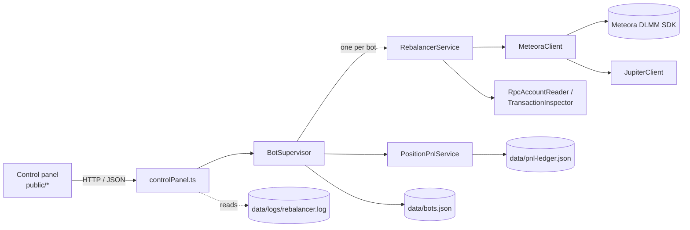
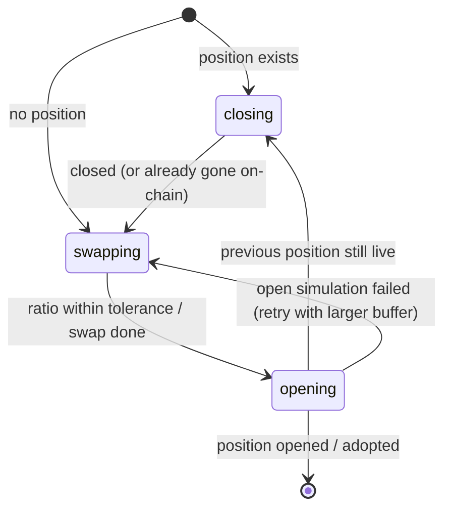

# Meteora DLMM Bot

[](https://github.com/OplopUser/MeteoraBot/actions/workflows/build-and-push.yml)

A self-hosted TypeScript bot that provides liquidity on [Meteora DLMM](https://docs.meteora.ag/) pools on Solana, re-centres positions when the price leaves the range, and tracks net PnL. It comes with a web control panel and runs on a Raspberry Pi through a prebuilt ARM64 Docker image.

> **Experimental software that signs real transactions with a hot wallet.** Read [Risks and limitations](#risks-and-limitations) before you fund it.

---

## Contents

- [Overview](#overview)
- [Features](#features)
- [How it works](#how-it-works)
- [Control panel](#control-panel)
- [Requirements](#requirements)
- [Setup](#setup)
- [Running locally](#running-locally)
- [Running with Docker / on a Raspberry Pi](#running-with-docker--on-a-raspberry-pi)
- [Maintenance scripts](#maintenance-scripts)
- [Testing](#testing)
- [Project structure](#project-structure)
- [Risks and limitations](#risks-and-limitations)
- [License](#license)

## Overview

Meteora's **Dynamic Liquidity Market Maker (DLMM)** splits a pool's price axis into discrete **bins**. Each bin covers a small price step (the pool's `binStep`, in basis points). Liquidity providers choose a range of bins and a distribution shape. Only the bin that holds the current price (the *active bin*) earns swap fees. When the price moves outside a position's bins, the position stops earning and sits entirely in one token.

This bot automates the upkeep around that:

1. It opens a position around the current price, using a configurable bin range and distribution strategy.
2. It polls the pool and detects when the price leaves the range, or gets close to its edge.
3. It closes the position, swaps through Jupiter to the token ratio the new range needs, and opens a fresh position centred on the current price.
4. It records each position's entry capital, fees, swap costs and transaction fees in a ledger, so the dashboard shows net PnL, not only fees earned.

Several bots, each tied to one pool, can run from the same wallet. All of them are managed from the control panel.

## Features

- **Multiple bots per wallet.** Each bot has its own pool, price range, strategy, allocation and polling interval. Bots are stored in a JSON registry.
- **Three DLMM distribution strategies:** `Spot` (uniform), `Curve` (concentrated around the centre) and `BidAsk` (weighted to the edges).
- **Out-of-range detection.** Several triggers are checked: active bin vs. position bins, price vs. position price bounds, the configured min/max range, and an optional "proactive" threshold that fires before the edge is reached.
- **Automatic rebalancing** in three phases (close → swap → open), with the phase saved to disk so a restart resumes where it stopped.
- **Timeout and failure recovery.** After a confirmation timeout, the bot checks on-chain state before retrying. Recoverable RPC errors are retried with backoff, and the deployment buffer grows after repeated open failures. A guard stops duplicate positions after an ambiguous open.
- **Allocation cap.** Each bot deploys at most its configured allocation (valued in USDC), even if the wallet holds more.
- **Fee compounding.** Claimed fees can be put back into the same position, either manually or automatically above a threshold.
- **PnL ledger.** Tracks open and closed positions: entry capital, current or exit value, fees earned, swap cost, transaction fees and net PnL, converted to USD.
- **Orphaned-position detection.** Shows DLMM positions in the wallet that no bot is tracking.
- **RPC failover** for account and transaction reads across a primary RPC and comma-separated fallbacks.
- **Web control panel and JSON API** to create, start, stop, pause, resume, rebalance, compound, close and archive bots.
- **Docker image for `linux/arm64`**, built and pushed to GHCR by GitHub Actions on every push to `main`.

## How it works

### Architecture



The `BotSupervisor` gives each bot a timer and polls it every `pollSeconds`, with a little random jitter. Everything that sends on-chain transactions (rebalances, compounding) goes through **one shared execution queue**. As a result, only one bot changes the wallet at a time.

### Bins and range selection

Bin math lives in `src/strategy/bins.ts`. A bin's price is `(1 + binStep / 10000) ^ binId`, adjusted for the difference in token decimals.

The bot picks the target range for a new position in one of two ways:

- **`rangeBins` set (> 0):** a range of `rangeBins` bins centred on the current price. An optional `trendShiftBins` moves the whole range in the direction the price drifted.
- **Otherwise:** the width of the bot's `minPrice`–`maxPrice` is kept and re-centred on the current price.

After every successful rebalance, the bot's `minPrice` / `maxPrice` are **overwritten with the new position's price bounds**. The next trigger is therefore measured against the live range.

Before opening, the bot works out the value split between token A and token B that the chosen strategy needs over that range (`computeTargetValueWeights`). If the wallet's split is off by more than `openBalanceToleranceBps`, it swaps the difference through Jupiter.

### Rebalance triggers

On every poll the bot reads the pool's active bin and price. It marks the bot as *triggered* when any of these is true:

| Trigger | Condition |
| --- | --- |
| Configured range | price ≤ `minPrice` or price ≥ `maxPrice` |
| Bin range | active bin < position's lower bin, or > position's upper bin |
| Price range | price outside the position's recorded lower/upper price |
| Proactive drift | `driftThresholdPct` > 0, and the price has moved that fraction (0–1) of the way from the range centre to an edge |
| Latched | the bot was already triggered on a previous cycle |

A bot with no active position opens one right away ("bootstrapping"). If the tracked position no longer exists on-chain, the bot clears its state and bootstraps a new one on the next cycle.

### Rebalance phases and recovery



Each step saves a `pendingRebalance` record (phase, transaction ids, retry counters, entry capital) to the bot's runtime state, so a crash or restart resumes the same phase.

- **Close:** claims fees, removes 100% of liquidity, then tries to close the empty position account to reclaim rent.
- **Swap:** refreshes the price, waits up to 20 seconds for post-close balances to arrive, caps balances to the allocation, holds back 0.1 SOL for rent and fees when one side is SOL, then swaps if needed.
- **Open:** opens the position by strategy. Ranges of up to 70 bins use a single transaction. Wider ranges create an extended position first and add liquidity in separate transactions. A deployment buffer (`openDeploymentBufferBps`) leaves a small margin unused.

Failures are handled as follows:

| Situation | Behaviour |
| --- | --- |
| Confirmation timeout / block height exceeded | Checks on-chain whether the close or open went through. Continues if it did, otherwise retries once. If the outcome is still unclear, pauses with an `Ambiguous … state after timeout` reason. |
| Recoverable RPC error (429, 5xx, network) | Retries automatically with linear backoff (5 s steps, max 60 s). After 12 attempts outside the close phase, it drops the pending rebalance and starts again from a fresh cycle. |
| Transaction simulation failure | Close and swap retry with backoff. A failed open goes back to the swap phase and increments `openFailureCount`. After `slippageRetriesPerTier` failures the deployment buffer moves to the retry tier, and after twice that to the final tier. |
| Position already exists in the pool before opening | Adopts it instead of opening a duplicate (guards against orphans after an ambiguous open). |
| Any other error | Pauses the bot and shows the reason in the panel. |

Bots paused by a plain timeout un-pause on the next cycle. Other pauses need **Resume**.

### PnL accounting

`PositionPnlService` writes one ledger record per position to `BOT_PNL_LEDGER_FILE`:

- **Entry capital:** the value of the tokens actually deployed after swaps and after the deployment buffer.
- **Swap cost:** the value lost between the pre-swap and post-swap balances.
- **Transaction fees:** network fees of the close, swap and open transactions, read back from the RPC.
- **Marks:** about once a minute, the open position's current token amounts and unclaimed fees are read and revalued.
- **Net PnL** = current (or exit) value − entry capital − swap cost − transaction fees.

Values are converted to USD directly when one side of the pool is USDC. For SOL-quoted pools, a SOL/USDC price is taken from another bot's SOL/USDC pool or from a Jupiter quote. If no price can be found, the record is skipped, or (as a last resort) the quote token is treated as $1. Open records whose position is gone from the chain and from every bot are reconciled to `closed`.

### RPC failover

Set `SOLANA_RPC_URL` plus an optional comma-separated `SOLANA_RPC_FALLBACK_URLS`. Balance, token-decimal and transaction-inspection reads rotate to the next URL on HTTP 408/409/425/429/5xx or network errors. Transaction sending and DLMM SDK calls use the **primary URL only**. When a bot's poll fails with a recoverable RPC error, the supervisor also backs off that bot's next poll to at least 30 seconds.

### Modules

| Module | Responsibility |
| --- | --- |
| `src/controlPanel.ts` | HTTP server: serves `public/` and the JSON API, entry point of the Docker image |
| `src/index.ts` | Legacy single-bot CLI entry point (see [Running locally](#running-locally)) |
| `src/config.ts` | Environment variable schema (zod) and defaults |
| `src/botConfig.ts` | Merges a bot's own settings over the global config |
| `src/services/botSupervisor.ts` | Bot lifecycle, polling timers, shared execution queue, USD price resolution |
| `src/services/rebalancer.ts` | Per-bot cycle: triggers, close/swap/open phases, recovery, compounding |
| `src/services/recovery.ts` | Pure functions that classify timeout outcomes |
| `src/services/positionPnlService.ts` | PnL ledger updates and dashboard snapshot (including orphaned positions) |
| `src/services/pnlMath.ts` | Net-PnL formulas, summaries, token→USD price resolution |
| `src/strategy/bins.ts` | Bin/price conversion, range computation, drift triggers, target weights |
| `src/clients/meteoraClient.ts` | Meteora DLMM SDK wrapper: positions, open/close, compounding, signing and sending with priority fee |
| `src/clients/jupiterClient.ts` | Jupiter quote and swap-instructions client with rate-limit retries |
| `src/infra/rpcAccountReader.ts` | JSON-RPC balance and decimals reads with failover |
| `src/infra/transactionInspector.ts` | Reads transaction fees and status with failover |
| `src/infra/rpcFailover.ts` | RPC URL list and recoverable-error classification |
| `src/state/*` | JSON persistence for the bot registry, runtime state and PnL ledger (atomic write via temp file + rename) |
| `src/logger.ts` | pino logger writing JSON to stdout and `LOG_FILE` |

## Control panel

`npm run ui` (or the Docker container) starts the control panel at **`http://<host>:8789`**. It binds to `HOST` (default `0.0.0.0`) and `UI_PORT` (default `8789`), and the page refreshes every 15 seconds.

The panel shows:

- **Summary row:** net, realized and open PnL, fees earned, total allocation of enabled bots, enabled/monitoring bot counts, open/closed position counts and the execution-queue depth. A warning appears when the wallet holds positions no bot is tracking.
- **Active LP positions:** price range with an in-range indicator, liquidity and claimable fees per token, and PnL. Bot-owned positions have **Compound** and **Close** buttons. Orphaned positions are labelled.
- **Bots:** one card per bot with pool, allocation, range, observed and anchor price, trigger state, current position, last action, PnL, pause reason and recovery status. Buttons: **Start**, **Stop**, **Rebalance**, **Compound**, **Resume**, **Archive**. An inline form edits name, allocation, range, strategy, poll interval, max slippage and auto-compound settings.
- **Create new bot:** pool address, range, strategy, allocation, poll interval, plus advanced slippage, buffer and tolerance settings. Token mints, decimals and bin step are read from the pool.
- **Position ledger:** every tracked position with entry capital, current or final value, net PnL and fees vs. costs.
- **Transactions:** close, swap, deposit, compound, trigger, recovery and failure events parsed from the log file, with filters by bot, type and status, plus free-text search.

> The control panel has **no authentication**. Anyone who can reach the port can move the wallet's funds into and out of positions. Keep it on a trusted LAN or behind a VPN or an authenticating reverse proxy, and never expose it to the internet directly.

### API

All endpoints return JSON.

| Method | Path | Description |
| --- | --- | --- |
| `GET` | `/api/status` | Wallet summary, bots, PnL summary, orphaned and all positions (cached for 5 s) |
| `GET` | `/api/wallet` | Wallet address, bot counts, total allocation, queue depth |
| `GET` | `/api/bots` | List bots with PnL summaries |
| `POST` | `/api/bots` | Create a bot (see [Bot settings](#bot-settings)) |
| `PATCH` | `/api/bots/:id` | Update a bot's settings |
| `DELETE` | `/api/bots/:id` | Archive a bot (stops it, **does not close its position**) |
| `POST` | `/api/bots/:id/start` | Enable and start monitoring |
| `POST` | `/api/bots/:id/stop` | Stop monitoring (position stays open) |
| `POST` | `/api/bots/:id/pause` | Pause with a reason (API only, no button in the UI) |
| `POST` | `/api/bots/:id/resume` | Clear the pause and resume monitoring |
| `POST` | `/api/bots/:id/rebalance` | Force a rebalance cycle now |
| `POST` | `/api/bots/:id/close-position` | Close the bot's active position |
| `POST` | `/api/bots/:id/compound` | Claim fees and deposit them back into the position |
| `GET` | `/api/bots/:id/transactions` | Last 60 events for one bot |
| `GET` | `/api/transactions[?botId=]` | Last 100 events |
| `GET` | `/api/pnl` | PnL summary, per-bot summaries, ledger records, orphaned positions |
| `GET` | `/api/pnl/positions` | Ledger records only |

### Bot settings

These settings are stored per bot in `BOT_REGISTRY_FILE`. The defaults shown are those pre-filled by the create form.

| Field | Default | Notes |
| --- | --- | --- |
| `name` | — | Falls back to `<A>/<B> Bot` if empty |
| `dlmmPoolAddress` | — | Meteora DLMM pool (lb pair) address |
| `minPrice`, `maxPrice` | — | Initial range in quote-per-base price; overwritten after each rebalance |
| `strategy` | `Spot` | `Spot`, `Curve` or `BidAsk` |
| `allocationUsdc` | `100` | Maximum value the bot deploys |
| `pollSeconds` | `15` | Poll interval |
| `maxSlippageBps` | `100` | Slippage passed to Jupiter swaps |
| `slippageRetriesPerTier` | `3` | Open failures before the deployment buffer moves up a tier |
| `openDeploymentBufferBps` / `openRetryDeploymentBufferBps` / `openFinalDeploymentBufferBps` | `100` / `300` / `500` | Share of balances held back when opening, per tier |
| `openBalanceToleranceBps` | `25` | Allowed deviation from the target token split before a swap is made |
| `closeRetrySlippageBps`, `closeFinalRetrySlippageBps`, `openRetrySlippageBps`, `openFinalRetrySlippageBps` | `300`, `1000`, `300`, `1000` | Stored, but not used by the current rebalancer |
| `minSwapQuoteValue` | `10` | Stored, but not used by the current rebalancer |
| `autoCompound` | `false` | Compound automatically when unclaimed fees exceed `compoundMinValueUsdc` |
| `compoundMinValueUsdc` | `0` | Threshold for auto-compound (valued in the pool's quote token) |
| `driftThresholdPct` | `0` | Proactive trigger as a fraction (0–1) of half the range; `0` disables it. **API only** |
| `rangeBins` | `null` | Fixed range width in bins; `null` keeps the min/max width. **API only** |
| `trendShiftBins` | `0` | Shift of the new range in the drift direction (only with `rangeBins`). **API only** |

"API only" fields have no UI control yet. Set them in the JSON body of `POST /api/bots` or `PATCH /api/bots/:id`, for example:

```bash
curl -X PATCH http://localhost:8789/api/bots/<bot-id> \
  -H 'content-type: application/json' \
  -d '{"rangeBins": 40, "driftThresholdPct": 0.8, "trendShiftBins": 3}'
```

## Requirements

- Node.js **≥ 20.11** (from `package.json` `engines`; the Docker image uses Node 23)
- A Solana mainnet RPC endpoint (a dedicated or paid one is recommended; public endpoints rate-limit heavily)
- A Solana keypair file for a **dedicated hot wallet**, funded with the pool's tokens plus SOL for fees and rent
- Optional: Docker with Compose, and a 64-bit OS for Raspberry Pi deployments (the published image is `linux/arm64` only)

## Setup

```bash
git clone https://github.com/OplopUser/MeteoraBot.git
cd MeteoraBot
npm ci
```

### Wallet keypair

The bot loads `BOT_WALLET_KEYPAIR_PATH`, a JSON array of secret-key bytes (the format `solana-keygen` writes):

```bash
solana-keygen new --outfile wallet.json
```

- Use a **new wallet created only for this bot**, and fund it with no more than you are prepared to lose.
- **Never commit the keypair.** `.gitignore` and `.dockerignore` already exclude `wallet.json`, `*keypair*.json`, `.env` and `data/`. Keep it that way.
- Restrict file permissions, e.g. `chmod 600 wallet.json`.

### Environment variables

Create a `.env` in the project root. `.env` values **override** variables already set in the environment (`dotenv` with `override: true`).

```dotenv
SOLANA_RPC_URL=https://your-rpc.example
SOLANA_RPC_FALLBACK_URLS=
BOT_WALLET_KEYPAIR_PATH=./wallet.json
```

**Required**

| Variable | Description |
| --- | --- |
| `SOLANA_RPC_URL` | Primary Solana RPC URL (used for everything, including sending transactions) |
| `BOT_WALLET_KEYPAIR_PATH` | Path to the wallet keypair JSON |

**Optional**

| Variable | Default | Description |
| --- | --- | --- |
| `SOLANA_RPC_FALLBACK_URLS` | *(empty)* | Comma-separated fallback RPC URLs for reads |
| `BOT_REGISTRY_FILE` | `./data/bots.json` | Bot definitions and runtime state |
| `BOT_PNL_LEDGER_FILE` | `./data/pnl-ledger.json` | PnL ledger |
| `LOG_FILE` | `./data/logs/rebalancer.log` | JSON log file (also the source of the Transactions table) |
| `LOG_LEVEL` | `info` | `fatal`, `error`, `warn`, `info`, `debug`, `trace` |
| `JUPITER_API_BASE_URL` | `https://lite-api.jup.ag/swap/v1` | Jupiter swap API base URL |
| `JUPITER_API_KEY` | *(empty)* | Sent as `x-api-key` when set |
| `HOST` | `0.0.0.0` | Control panel bind address |
| `UI_PORT` | `8789` | Control panel port |

**Global trading defaults.** In the control panel each bot's own settings override these values (`src/botConfig.ts`). They only take effect in the legacy CLI.

| Variable | Default |
| --- | --- |
| `POLL_SECONDS` | `15` |
| `MAX_SLIPPAGE_BPS` | `100` |
| `SLIPPAGE_RETRIES_PER_TIER` | `3` |
| `OPEN_DEPLOYMENT_BUFFER_BPS` | `100` |
| `OPEN_RETRY_DEPLOYMENT_BUFFER_BPS` | `300` |
| `OPEN_FINAL_DEPLOYMENT_BUFFER_BPS` | `500` |
| `OPEN_BALANCE_TOLERANCE_BPS` | `25` |

**Parsed but currently unused:** `DEFAULT_STRATEGY` (`Spot`), `CLOSE_RETRY_SLIPPAGE_BPS` (`300`), `CLOSE_FINAL_RETRY_SLIPPAGE_BPS` (`1000`), `OPEN_RETRY_SLIPPAGE_BPS` (`300`), `OPEN_FINAL_RETRY_SLIPPAGE_BPS` (`1000`), `SOL_RESERVE_LAMPORTS` (`50000000`; the SOL reserve is hard-coded to 0.1 SOL), `MIN_SWAP_USDC` (`10`).

## Running locally

| Command | What it does |
| --- | --- |
| `npm run ui` | Starts the control panel and bot supervisor (`tsx src/controlPanel.ts`). **This is the main way to run the bot.** |
| `npm test` | Runs the Vitest suite |
| `npm run typecheck` | `tsc --noEmit` |
| `npm run build` | Compiles TypeScript to `dist/` (used as a check; the app itself runs through `tsx`) |
| `npm run run` / `npm run dry-run` / `npm run rebalance-now` | Legacy single-bot CLI (`src/index.ts`). It does not currently pass a pool address to the rebalancer, so it only logs `no pool address configured`. Use the control panel instead. |

Typical first run:

1. `npm run ui` and open `http://localhost:8789`.
2. Under **Create New Bot**, enter the pool address, a price range and a small allocation. The bot is created stopped.
3. Press **Start**. A bot with no position **opens one straight away**, swapping first if needed.

Runtime data (`bots.json`, `pnl-ledger.json`, logs) is written to `./data/`.

## Running with Docker / on a Raspberry Pi

The GitHub Actions workflow (`.github/workflows/build-and-push.yml`) builds a `linux/arm64` image with QEMU/Buildx on every push to `main`. It pushes the image to GHCR as `ghcr.io/<owner>/<repo>:latest` and `:<commit-sha>`.

The image:

- compiles TypeScript in a build stage (as a check), then runs `src/controlPanel.ts` through `tsx` on Node 23;
- patches `@meteora-ag/dlmm`'s `package.json` to force its CommonJS build, which works around an ESM import problem with `@coral-xyz/anchor`;
- exposes port `8789`.

On the Pi (64-bit OS), next to `docker-compose.yml`:

```bash
mkdir -p data
cp /path/to/wallet.json ./wallet.json && chmod 600 wallet.json
# .env: set BOT_WALLET_KEYPAIR_PATH=/app/wallet.json and your RPC URL(s)
docker compose pull
docker compose up -d
docker compose logs -f
```

`docker-compose.yml`:

- reads `.env` via `env_file`;
- mounts `./data` → `/app/data` (registry, ledger and logs survive restarts);
- mounts `./wallet.json` → `/app/wallet.json` read-only;
- publishes `8789:8789`, restarts `unless-stopped` and rotates Docker logs (3 × 10 MB).

If the GHCR package is private, run `docker login ghcr.io` first. On an x86 host, build the image yourself (`docker build -t meteora-bot .`) and point `image:` in the compose file at it. The published image is ARM64 only.

## Maintenance scripts

One-off helpers in `scripts/`. Run them with `tsx`; they read the same `.env`:

```bash
npx tsx scripts/list-positions.ts
```

| Script | What it does |
| --- | --- |
| `scripts/list-positions.ts` | Lists the wallet's positions in one pool with total X/Y amounts and non-empty bin counts. Read-only. |
| `scripts/check-balance.ts` | Prints how many DLMM positions the wallet still has, plus its SOL and USDC balances. The USD estimate uses a **hard-coded** SOL price, so treat it as rough. Read-only. |
| `scripts/force-close.ts` | **Sends transactions.** Closes every wallet position in one pool except the address in the `ACTIVE_POSITION` environment variable. **If `ACTIVE_POSITION` is not set, it closes all of them.** |

`list-positions.ts` and `force-close.ts` target a pool address hard-coded in the `pool` constant at the top of each file (a SOL/USDC pool). Edit it before using them on another pool. Stop the bot before running `force-close.ts`:

```bash
ACTIVE_POSITION=<position-to-keep> npx tsx scripts/force-close.ts
```

## Testing

```bash
npm test
```

`tests/bins.test.ts` covers the pure strategy math in `src/strategy/bins.ts`: price↔bin conversion and round-trips, range and price-band computation, centred ranges, min/max and bin-level drift triggers (including boundaries and negative bin ids), target value weights for all three strategies, and base-unit conversion. On-chain behaviour (DLMM, Jupiter, RPC) has no automated tests. The CI workflow builds the Docker image but does not run the tests.

## Project structure

```text
.
├── src/
│   ├── controlPanel.ts        # HTTP server + JSON API (main entry point)
│   ├── index.ts               # legacy CLI entry point
│   ├── config.ts              # env schema and defaults
│   ├── botConfig.ts           # per-bot config overlay
│   ├── domain.ts              # shared types
│   ├── logger.ts              # pino logger (stdout + file)
│   ├── clients/               # Meteora DLMM and Jupiter clients
│   ├── infra/                 # RPC reads, failover, tx inspection
│   ├── services/              # supervisor, rebalancer, recovery, PnL
│   ├── state/                 # JSON stores (registry, ledger, state)
│   └── strategy/bins.ts       # bin math and triggers
├── public/                    # control panel (HTML, CSS, vanilla JS)
├── scripts/                   # maintenance scripts
├── tests/bins.test.ts         # Vitest unit tests
├── Dockerfile                 # multi-stage image, runs the control panel
├── docker-compose.yml         # Pi / server deployment
└── .github/workflows/         # ARM64 image build and push to GHCR
```

## Risks and limitations

- **Real funds, experimental code.** The bot signs and sends mainnet transactions from a hot wallet without asking. Bugs, RPC problems or bad settings can lose money. There are no guarantees of any kind; use small amounts.
- **Impermanent loss and rebalancing costs.** Concentrated liquidity loses value against holding when the price trends. Each rebalance realises that loss and pays swap slippage, priority fees and rent. In fast or trending markets, frequent rebalancing can cost more than the fees earned.
- **No authentication on the control panel.** See [Control panel](#control-panel).
- **One bot per pool.** Before opening, the bot adopts any other wallet position in its pool. Running two bots on the same pool, or holding manual positions in a bot's pool, will confuse it.
- **Close while running reopens.** **Close** on a running bot closes the position, and the next cycle bootstraps a new one. Press **Stop** first if you want the funds to stay out. **Archive** and **Stop** leave the current position open.
- **Shared wallet allocation.** `allocationUsdc` caps each bot by value, but nothing reserves funds between bots. Over-allocation is not detected.
- **Fixed parameters.** Priority fee is a fixed 50,000 micro-lamports per compute unit on Meteora transactions. The SOL reserve is a fixed 0.1 SOL. Several stored slippage settings are not wired in yet (see the tables above).
- **USD values are approximations.** The positions table treats the quote token as USD. Ledger conversion depends on a SOL/USDC reference and falls back to quote = $1.
- **Token coverage.** Balance reads cover native SOL and SPL Token program accounts. Token-2022 balances are not read. Token symbols come from a small built-in list, otherwise a shortened mint.
- **Single process, JSON files.** State lives in JSON files under `data/`. Run only one instance per data directory. The Transactions view re-reads the entire log file on each request. The log file itself is not rotated by the app.
- **No input validation on the API** beyond what the UI form enforces.
- **Not financial advice.** This is a personal engineering project.

## License

No license file yet — all rights reserved.
